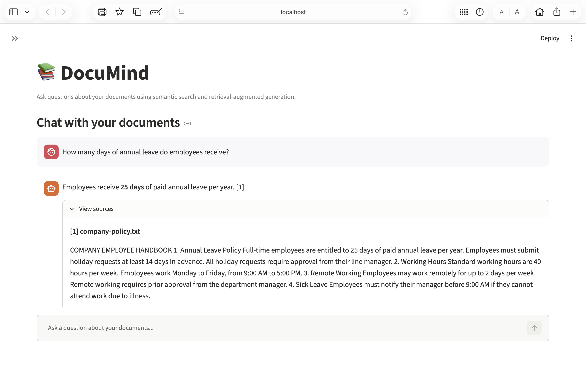
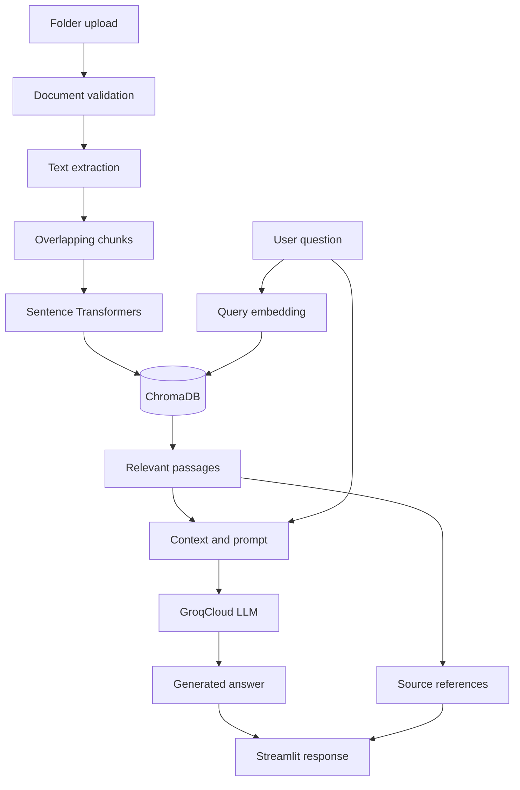

# DocuMind

[](https://github.com/youcef9997/DocuMind/actions/workflows/ci.yml)

**Document intelligence powered by retrieval-augmented generation.**



DocuMind is a Python application that lets users index collections
of documents and ask natural-language questions about their contents.

It combines local document processing, semantic search, persistent
vector storage and hosted language-model inference to generate
answers with traceable source references.

Built as a zero-cost software engineering portfolio project.

## Features

- **Folder uploads:** Process multiple PDF, TXT and Markdown files.
- **Document validation:** Reject unsupported, empty and oversized files.
- **Text extraction:** Preserve filenames and PDF page references.
- **Chunking:** Split documents into overlapping, configurable passages.
- **Semantic search:** Retrieve relevant passages using local embeddings.
- **Persistent indexing:** Store embeddings in ChromaDB across restarts.
- **AI question answering:** Generate responses using GroqCloud.
- **Source inspection:** Display retrieved passages alongside answers.
- **Interactive interface:** Upload, index and query documents in Streamlit.
- **Automated testing:** Validate core functionality using pytest and CI.

## Architecture



### Processing pipeline

**Ingestion:** PyMuPDF extracts text from PDF pages. TXT and Markdown
documents are decoded as UTF-8. Empty or invalid documents are rejected.

**Chunking:** Documents are divided into overlapping word-based
passages. Each passage retains its filename and page metadata.

**Embeddings:** Sentence Transformers converts passages and queries
into numerical vectors using `all-MiniLM-L6-v2`.

**Retrieval:** ChromaDB performs cosine-distance similarity search
against the persistent local vector index.

**Generation:** Selected passages and the user's question are sent
to GroqCloud. The model is instructed to answer using the supplied
context and reference supporting passages.

## Technology stack

| Component | Technology |
|-----------|------------|
| Language | Python 3.13 |
| Interface | Streamlit |
| PDF extraction | PyMuPDF |
| Embeddings | Sentence Transformers |
| Vector database | ChromaDB |
| Language-model API | GroqCloud |
| Testing | pytest |
| Continuous integration | GitHub Actions |

## Getting started

### Prerequisites

- Python 3.13
- Git
- Internet access
- A GroqCloud API key with access to a supported chat model

### Installation

Clone the repository:

```bash
git clone https://github.com/youcef9997/DocuMind.git
cd DocuMind
```

Create a virtual environment:

```bash
python3 -m venv .venv
source .venv/bin/activate
```

On Windows, activate with `.venv\Scripts\activate`.

Install dependencies:

```bash
python -m pip install -r requirements.txt
```

### Configuration

Copy the environment template:

```bash
cp .env.example .env
```

Edit `.env`:

```dotenv
GROQ_API_KEY=your_api_key
GROQ_MODEL=openai/gpt-oss-20b
```

Use a supported chat model available to your Groq account.

Never commit your `.env` file or expose your API key.

### Launch the application

```bash
python -m streamlit run app/ui.py
```

Open http://localhost:8501.

## Usage

1. Open the document library sidebar.
2. Select a folder containing supported documents.
3. Click **Index documents**.
4. Wait for indexing to finish.
5. Enter a question in the chat.
6. Expand **View sources** to inspect retrieved passages.

The application currently supports a maximum of 10 MB per file
and 50 selected files per indexing batch.

## Screenshots

### Document question answering


## Testing

Run the full test suite:

```bash
python -m pytest tests/ -v
```

Check Python source syntax:

```bash
python -m compileall -q app tests
```

Tests use deterministic fake embeddings and mocked language-model
clients where appropriate. They do not require paid inference requests.

## Continuous integration

GitHub Actions runs validation on pushes to `main` and pull
requests targeting `main`.

The pipeline:

1. Checks out the repository.
2. Installs Python 3.13.
3. Installs project dependencies.
4. Checks Python syntax.
5. Runs the pytest suite.

CI does not require Groq API credentials.

## Security and privacy

Document extraction, embeddings and ChromaDB indexing run locally.

When a user asks a question, the application sends the question
and retrieved document passages to GroqCloud for answer generation.

Local documents, vector database files and API credentials are
excluded from Git version control.

Do not use sensitive or confidential documents without reviewing
the hosted inference provider's data-handling requirements.

## Known limitations

- Scanned PDFs without an extractable text layer are unsupported.
- Retrieval uses word-based chunks rather than token-aware splitting.
- Re-indexing edited documents does not automatically remove stale chunks.
- Files with identical names and text may share chunk identifiers.
- Retrieved passages are displayed as sources, but individual model
  citations are not independently verified.
- The application does not implement user accounts or document isolation.
- Hosted generation requires internet access and is subject to free-tier
  model availability and rate limits.
- The application is intended as a single-user prototype rather than
  a production-ready multi-tenant service.

## Future improvements

- Document deletion, replacement and collection management.
- Relevance thresholds and improved retrieval evaluation.
- Token-aware chunking and reranking.
- Citation verification and grounded-answer evaluation.
- FastAPI backend with a dedicated frontend.
- Authentication and multi-user document isolation.
- Containerisation and deployment.

## Project status

**Working MVP — active development**

DocuMind demonstrates a complete document-processing and
retrieval-augmented question-answering workflow, with automated
regression testing and continuous integration.
